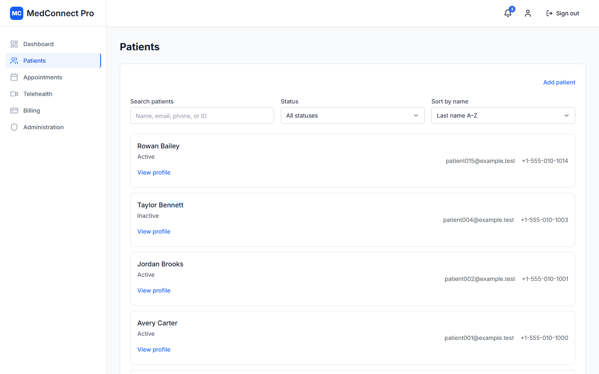
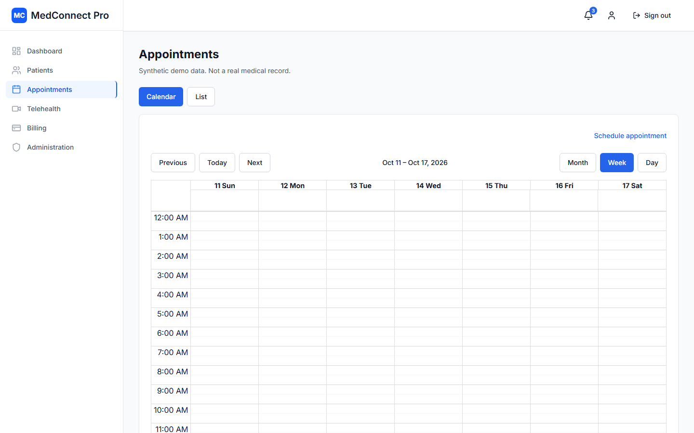
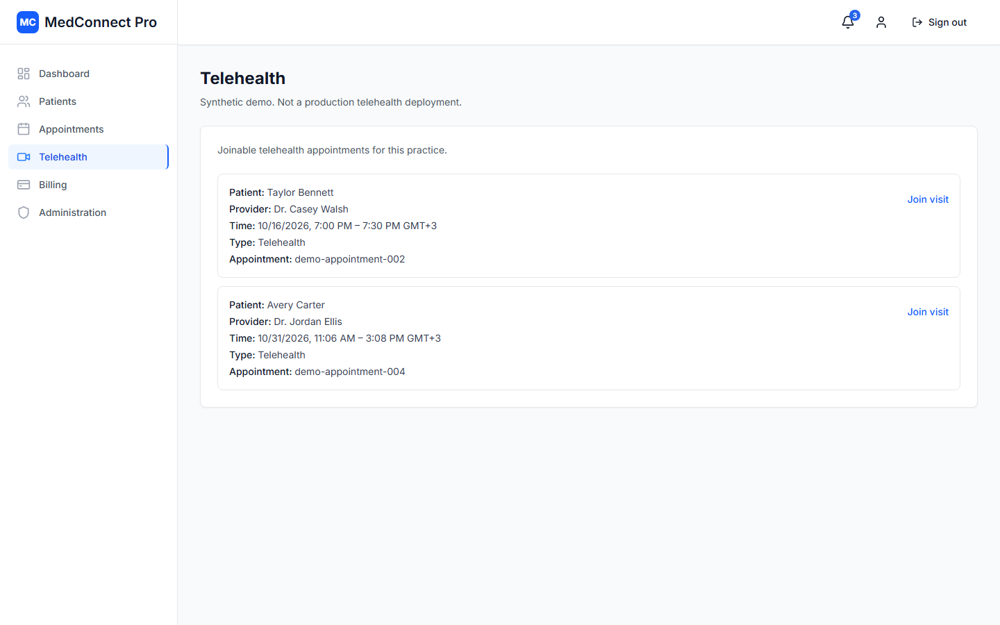
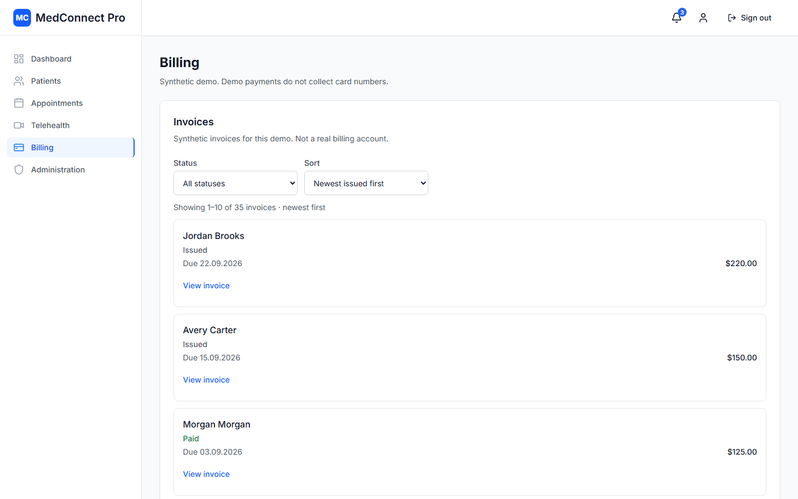
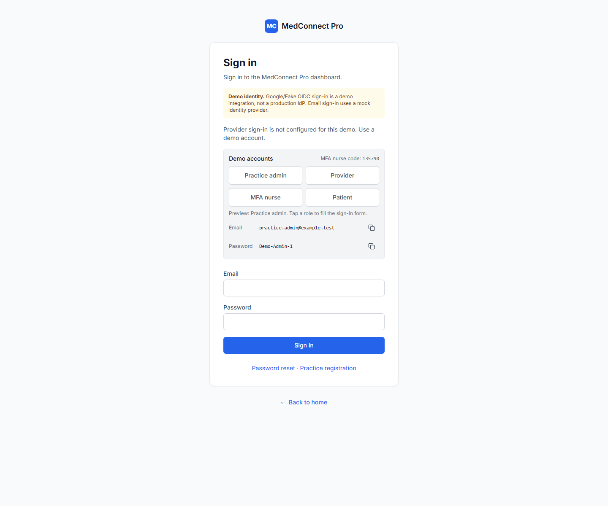
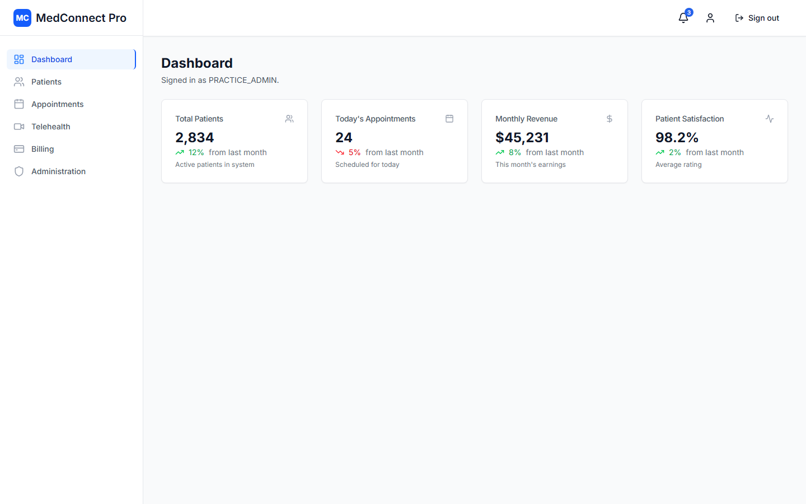
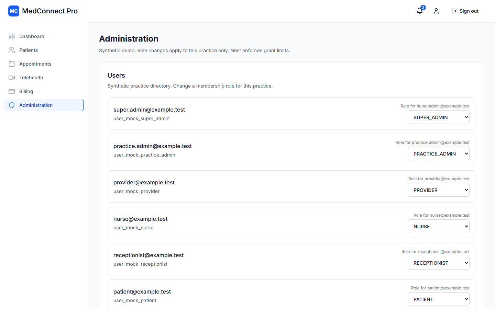
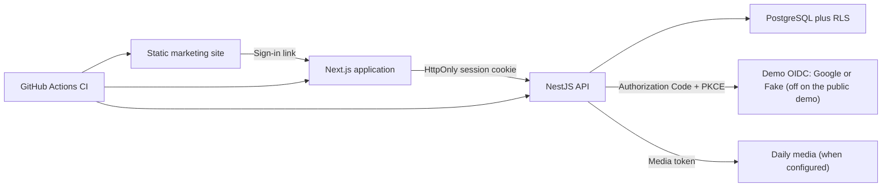

# MedConnect Pro

Feature-rich healthcare SaaS **demonstration** for portfolio, technical interviews, and
potential-client presentations.

The repository is a multi-tenant practice platform: a Next.js dashboard and public marketing
site, plus a modular NestJS API with RBAC, PostgreSQL row-level security, and audit logging.
Engineering is production-oriented. This is **not** a deployed healthcare service.

Canonical product, architecture, contract, and task documentation lives in
[`/docs`](./docs/README.md).

## Disclaimer

All records, credentials, and clinical content are **synthetic demo data**. Do not introduce real
patient records, identifiers, or other PHI ([ADR-005](./docs/decisions/ADR-005-synthetic-demo-data.md)).

Healthcare-oriented and HIPAA-oriented describe demonstrated engineering patterns. The demo is
**not** HIPAA certified, HIPAA compliant, or suitable for real patient data.

## Screenshots

Synthetic demo screens from the authenticated app. Not a production medical record. Dashboard
cards are live Nest aggregates in `dev:real` (fixture cards when mocks are on); telehealth is a session shell with demo Daily media when configured; identity is a labeled mock IdP.

<p align="center">
  
</p>

<table>
  <tr>
    <td width="33%">
      
    </td>
    <td width="33%">
      
    </td>
    <td width="33%">
      
    </td>
  </tr>
</table>

<details>
<summary>More screenshots</summary>

<table>
  <tr>
    <td width="33%">
      
    </td>
    <td width="33%">
      
    </td>
    <td width="33%">
      
    </td>
  </tr>
</table>
</details>

## Key capabilities

Statused catalog: [`docs/product/`](./docs/product/README.md).
Public-claim ceiling: [`docs/marketing/capability-matrix.md`](./docs/marketing/capability-matrix.md).

| Module | In the demo | Limit |
| --- | --- | --- |
| Identity | Mock IdP login, logout, Nest HttpOnly cookies, opaque bearer JSON for machine clients, and labeled mock MFA | Public demo does not configure provider sign-in. Not production OAuth or production MFA |
| Patients | Directory, profiles, clinical lists, document list/download | Synthetic data only; no external EHR |
| Scheduling | Calendar, appointments, provider availability | No waitlist or check-in / check-out |
| Telehealth | Create, join, and end an appointment-linked session shell with demo Daily media when configured | Not production telehealth, HIPAA video, chat, or recording |
| Billing | Invoice list and detail, demo record-payment, labeled claims envelopes | Not hosted payments or claims submission |
| Analytics | Live Nest dashboard overview cards | Synthetic demo aggregates; not a warehouse or HIPAA analytics |
| Administration | User directory, audit viewer, role assignment, and tenant-scoped security-events viewer | Not a permission-matrix editor, SIEM, or HIPAA audit export |
| Security | Server-side RBAC, tenant isolation (including RLS), audit logging, document ACL | Not HIPAA certification |

Notification **in-app inbox** exists on the dashboard Bell (session user only). It is not push,
SMS, or email delivery.

## Tech stack

### Frontend (`apps/web`)

- Next.js App Router, React, TypeScript
- TanStack Query
- React Hook Form + Zod
- Tailwind CSS, Headless UI, Lucide React
- Recharts, React Big Calendar

Daily SDK is wired as a custom call object on the telehealth session shell when the API has
`DAILY_API_KEY`. Socket.IO remains unwired. Chat and recording are **not** in the demo.

### Backend (`apps/api`)

- Node.js current LTS, NestJS 12, TypeScript
- REST + OpenAPI (`npm run openapi:generate`, `/api/docs-json`, optional `/api/docs`)
- PostgreSQL 18 (local Compose + TypeORM, including RLS)

Redis, S3/KMS as a local runtime, and WebSockets / Socket.IO are **not** wired in the running
demo. Daily media is labeled unavailable when `DAILY_API_KEY` is unset.

### Infrastructure in the repository

- Docker Compose for local PostgreSQL
- GitHub Actions quality gates on pull requests and `main`
  ([`.github/workflows/ci.yml`](./.github/workflows/ci.yml))
- Terraform ([`infra/terraform/`](./infra/terraform/)), Amplify buildspec
  ([`amplify.yml`](./amplify.yml)), ECS production workflow
  ([`.github/workflows/production-deploy.yml`](./.github/workflows/production-deploy.yml))

Hosted Amplify + ECS is coded; first AWS apply is still an operator step. Do not describe the
demo as hosted on AWS.

ADRs: [`docs/decisions/`](./docs/decisions/).

## Architecture

Implemented local / CI path. The public site is `apps/marketing`. The authenticated application
is `apps/web`. Nest owns authorization and data.



`npm run dev:mocks` runs the web app on mock fixtures with no API. `dev:real` runs
it against Nest and PostgreSQL. Detail: the [architecture overview](./docs/architecture/README.md)
(system map, current vs planned, links to the frontend, backend, API, data, security and
infrastructure docs), the [request lifecycle](./docs/architecture/request-lifecycle.md) (one
request from browser to database and back), and the [ADR index](./docs/decisions/README.md)
(each decision and its main tradeoff).

Amplify Hosting and ECS/Fargate exist as infrastructure-as-code for a later operator apply
([INFRA-014](./docs/tasks/infrastructure/INFRA-014-aws-account-setup-and-hosted-first-apply.md)).
They are not the live public demo. The interim public demo is Render
([ADR-017](./docs/decisions/ADR-017-interim-render-demo.md),
[ADR-018](./docs/decisions/ADR-018-render-marketing-static-site.md)). Do not describe the demo as
hosted on AWS.

## Development status

Application version **0.103.6**. Milestones and sequencing:
[`docs/roadmap/release-roadmap.md`](./docs/roadmap/release-roadmap.md). Next: the 1.0.0 Render
demo release
([INFRA-021](./docs/tasks/infrastructure/INFRA-021-v1.0.0-demo-release.md)), after M20 closes.

- **M0–M8 shipped**, including the public marketing site (FE-017–FE-023).
- **M9 — Deployment / preview infrastructure** is **PAUSED / BLOCKED** — AWS account setup
  unavailable. Not closed and not cancelled: INFRA-004–INFRA-012 shipped, INFRA-014 pending
  (blocks INFRA-013), INFRA-013 paused.
- **M10 shipped** (DATA-002, BE-011, FE-024, BE-012, FE-025, BE-013, FE-026): live Nest dashboard
  overview, in-app notification inbox/preferences, and practice role assignment.
- **M11 shipped** (BE-014, FE-027, FE-028, BE-015, FE-029, SEC-005): Nest HttpOnly cookies, live
  cookie client, mock MFA UI, security-events HTTP/UI, and production-gap docs
  ([docs/security/](./docs/security/README.md)). **M12 — Telehealth Media Maturity** is shipped
  ([BE-016](./docs/tasks/backend/BE-016-telehealth-daily-media-token-http.md),
  [FE-030](./docs/tasks/frontend/FE-030-daily-media-session-shell.md)). **M13 — Billing / Payments UX**
  is shipped ([FE-031](./docs/tasks/frontend/FE-031-record-demo-payment.md),
  [FE-032](./docs/tasks/frontend/FE-032-claims-envelope-list.md)). Hosted Stripe/ACH, claims
  submission / EDI 837, and invoice-create UI remain later.
- **M14–M17 shipped** (OAuth/OIDC demo, API rate limiting, live telehealth workflow, and security
  maturity through QA-005).
- **M18 — Interview Demo Readiness** closed at 0.91.0. It does not close M9. Local product work
  does not wait on AWS.
- **M19 — Polish and list normalization** closed at 0.96.3: paged and bounded lists for
  patients, invoices, claims, users, audit and security events, plus billing design parity.
- **M20 — PR previews and delivery lanes** is in progress: manual Render PR previews for the
  marketing site and web app are shipped; QA-010 is pending.
- **M21 — Marketing and web app design refresh** closed at 0.103.1: refreshed marketing pages
  (including `/architecture` and the `/about` roadmap board), app form-surface parity, US date
  format with an accessible date picker, design-system select lists, a one-tap demo account
  picker on `/login`, and repeatable screenshot capture (`npm run screenshots:marketing`).

Deferred relative to the complete-product vision: production OAuth 2.0 / OIDC + PKCE, in-session
chat/recording, hosted payments and claims, Redis, AWS production hosting, and HIPAA certification
(out of scope for this demo).

## Deployment / demo

The interim public demo is on Render. Records are synthetic. This demo is **not** HIPAA certified.
Hosted Amplify and ECS are coded for a later operator apply. They are not this public demo.

- Application: [https://medconnectpro.app](https://medconnectpro.app)
- Marketing site: [https://marketing.medconnectpro.app](https://marketing.medconnectpro.app)
- API health: [https://api.medconnectpro.app/health](https://api.medconnectpro.app/health)

### Demo accounts

These are the existing synthetic fixtures. The MFA nurse code is `135790`.

| Role | Email | Password |
| --- | --- | --- |
| Practice admin | `practice.admin@example.test` | `Demo-Admin-1` |
| Provider | `jordan.ellis@synthetic.example` | `Demo-Provider-1` |
| MFA nurse | `mfa.nurse@example.test` | `Demo-Mfa-1` |
| Patient | `avery.quinn@synthetic.example` | `Demo-Patient-1` |

### Known limits

- Free web services sleep after about 15 minutes without traffic. The first request can be slow.
- The Free Postgres database expires on 2026-11-13.
- Uploaded documents disappear when the free API service sleeps, restarts, or redeploys.
- Daily video works only when the operator has set `DAILY_API_KEY`. Otherwise the session shell says media is unavailable.
- Provider sign-in is not configured on the public demo. Email sign-in uses the mock identity provider.
- All records are synthetic. This demo is not HIPAA certified.

Local development stays available:

- UX-only: `npm run dev:mocks`, then [http://localhost:3000](http://localhost:3000).
- Live Nest: Compose PostgreSQL, migrations, `seed:mock-identity`, `dev:api`, `dev:real`.
  Commands are in [Getting started](#getting-started).

CI quality gates run on pull requests and `main`. Manual Render PR previews are described in
[ADR-019](./docs/decisions/ADR-019-render-pr-previews.md). The AWS topology
([ADR-012](./docs/decisions/ADR-012-deployment-topology.md)) still needs an operator first apply,
Amplify console connect, and the GitHub `production` environment before an AWS-hosted environment
exists. All environments, if applied later, stay synthetic/demo only.

## Repository layout

This repository is an **npm workspaces** monorepo.

```text
medconnect-pro/
  apps/web/          Next.js frontend
  apps/api/          NestJS API (platform foundation)
  apps/api/openapi/  Generated OpenAPI (`npm run openapi:generate`)
  packages/          Reserved for future shared packages
  postman/           Postman environments and collection conventions
  docs/              Canonical documentation
  infra/terraform/   M9 Terraform root (secrets, RDS, ECS)
  amplify.yml        Amplify Hosting buildspec for apps/web
  .github/workflows  GitHub Actions quality gates (`ci.yml`)
  .cursor/rules/     Project Cursor rules
  scripts/plane/     Plane task sync
```

The backend is a **separate modular NestJS application** under `apps/api`. Do not fold backend
domain logic into the Next.js app.

Frontend role and nav checks are UX only. Server-side authorization and tenant isolation in
`apps/api` are the authoritative controls.

## Security model

The demo models healthcare-oriented engineering patterns. **Implemented:** mock IdP sessions, mock
MFA challenge, demo OIDC + PKCE (Google or Fake) only when provider sign-in is enabled, RBAC and
resource-level authorization, tenant isolation (including PostgreSQL RLS), audit logging,
least-privilege database role, secrets outside source control. The public demo leaves provider
sign-in unset and does not complete Google or Fake sign-in.

**Target, not implemented:** production OAuth and a production identity provider, production MFA,
encryption at rest as an infrastructure property, TLS at the deployment edge.

The frontend may use a **mock identity / session** for demonstration. Mock authentication is not
production identity infrastructure.

### Roles

`SUPER_ADMIN`, `PRACTICE_ADMIN`, `PROVIDER`, `NURSE`, `RECEPTIONIST`, `PATIENT`

Authorization follows: identity → tenant / practice → role → permission → resource
ownership or assignment.

## Getting started

Local development is the Next.js app in `apps/web` (mock-first) plus the NestJS API in `apps/api`.
PostgreSQL is Docker Compose at the repository root (`docker compose up -d`, image
`postgres:18-alpine`). Redis is not part of this setup.

### Prerequisites

- Node.js **24** (Active LTS). See `.nvmrc` and the root `package.json` `engines` field.
- npm **10.x** or later
- Docker (for local PostgreSQL)

### Installation

1. Clone the repository.
2. Copy [`apps/web/.env.example`](./apps/web/.env.example) to `apps/web/.env.development`. Do not
   commit `.env.development`, `.env.test`, or secrets. For Vitest/Playwright local overrides, copy
   the example to `apps/web/.env.test` and set mock delay/error rate to `0` as noted in that file.
3. Install dependencies from the **repository root**:

```bash
npm install
```

4. Start local PostgreSQL and apply migrations (owner role). Nest runtime must use `medconnect_app`
   (`DATABASE_URL` in [`apps/api/.env.example`](./apps/api/.env.example)); do not point it at the
   table owner or row-level security is bypassed:

```bash
docker compose up -d
npm run migration:run
```

5. Start the frontend with mocks for UX-only work:

```bash
npm run dev:mocks
```

6. For live Nest APIs, start PostgreSQL (step 4), seed demo identity, start the API, then the
   frontend with mocks off:

```bash
npm run seed:mock-identity
npm run dev:api
npm run dev:real
```

7. Open [http://localhost:3000](http://localhost:3000).

`npm run dev` starts Next.js using `.env.development` (mock-first in the example).
`npm run dev:real` sets `NEXT_PUBLIC_USE_MOCKS=false`. The browser then calls Nest at
`NEXT_PUBLIC_API_BASE_URL` (default `http://localhost:3001`) with the bearer from `POST /auth/login`.
Live dashboard overview cards use Nest `GET /dashboard/overview`. Mock mode still renders fixtures.
The same commands exist as `dev:web` aliases.

### Local versus hosted

Local development (`APP_ENV=local`) uses Compose PostgreSQL and the committed `.env.example`
files. It does not require AWS credentials. Preview and production are separate hosted
environments with isolated demo databases
([ADR-012](./docs/decisions/ADR-012-deployment-topology.md),
[environment-configuration.md](./docs/contracts/environment-configuration.md)). Copy
`.env.preview.example` / `.env.production.example` only as placeholders; real
`.env.preview` / `.env.production` stay gitignored. Hosted API boot fails closed if database
URLs are missing or still point at Compose. All three databases are synthetic/demo only.

### Useful commands

Run these from the repository root:

```bash
npm run lint
npm run lint:api
npm run type-check
npm run type-check:api
npm test
npm run test:api
npm run test:watch
npm run test:coverage
npx playwright install chromium   # once per machine, before E2E; run from apps/web if needed
npm run e2e
npm run build
npm run build:api
npm run clean                     # Next.js/test output under apps/web
npm run reset                     # clean + reinstall node_modules (cross-platform)
npm run dev:api                   # NestJS API on http://localhost:3001
npm run openapi:generate          # Write apps/api/openapi/openapi.json
npm run migration:run             # Apply TypeORM migrations to local Postgres
```

Pull requests and pushes to `main` run the same lint, type-check, test, and build commands via
[`.github/workflows/ci.yml`](./.github/workflows/ci.yml) (plus `npm run migration:run` before
`test:api`, and `npm audit --omit=dev`). Playwright e2e is local/release smoke, not every PR.
A failing quality-gate step fails the workflow. Mark the `ci` GitHub check required on `main` so
merges stay fail-closed.

Frontend testing conventions: [docs/workflows/frontend-testing.md](./docs/workflows/frontend-testing.md).

API contracts and Postman: [docs/workflows/api-contract-workflow.md](./docs/workflows/api-contract-workflow.md).
`npm run dev:api`, `npm run test:api`, and `npm run openapi:generate` are available. Import
`apps/api/openapi/openapi.json` into Postman as **MedConnect Pro API**.

## Documentation

| Path | Purpose |
| --- | --- |
| [`docs/README.md`](./docs/README.md) | Documentation map and source-of-truth hierarchy |
| [`docs/00-project-spec.md`](./docs/00-project-spec.md) | Project identity, goals, and constraints |
| [`docs/product/`](./docs/product/README.md) | Statused capability catalog (what the demo is today) |
| [`docs/marketing/capability-matrix.md`](./docs/marketing/capability-matrix.md) | Public-claim ceiling |
| [`docs/architecture/`](./docs/architecture/README.md) | System overview, request lifecycle, area docs |
| [`docs/decisions/`](./docs/decisions/README.md) | Architectural decision records and index |
| [`docs/contracts/`](./docs/contracts/) | API, identity, and environment contracts |
| [`docs/roadmap/post-mvp-baseline.md`](./docs/roadmap/post-mvp-baseline.md) | M0–M8 shipped snapshot (historical) |
| [`docs/roadmap/release-roadmap.md`](./docs/roadmap/release-roadmap.md) | Milestones, current position, and 1.0.0 plan |

Process prompts, tasks, and remaining workflows are linked from
[`docs/README.md`](./docs/README.md). Plane can mirror task metadata; Git remains canonical for
requirements, architecture, ADRs, and task definitions.

## License

Proprietary — all rights reserved.
