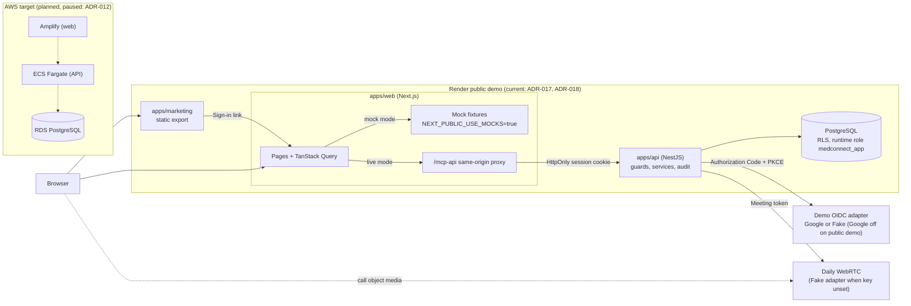

# Architecture overview

MedConnect Pro is a synthetic healthcare SaaS demo: a static marketing site, a Next.js application,
one modular NestJS API and one PostgreSQL database. Nest owns identity, authorization, tenant scope
and audit. The browser only talks to the Next.js origin. The demo is not HIPAA certified and holds
synthetic data only ([ADR-005](../decisions/ADR-005-synthetic-demo-data.md)).

## System map

Dashed AWS nodes are planned infrastructure-as-code that has not been applied. PR previews run the
web app in mock mode only and never reach the API or database
([ADR-019](../decisions/ADR-019-render-pr-previews.md)).

## Mock vs live mode

- **Live:** `apps/web` calls `/mcp-api` on its own origin. The route forwards to Nest and passes
  session cookies back, so cookies stay first-party and host-only
  ([ADR-017](../decisions/ADR-017-interim-render-demo.md),
  [ADR-018](../decisions/ADR-018-render-marketing-static-site.md)). Local: `npm run dev:real`.
- **Mock:** with `NEXT_PUBLIC_USE_MOCKS=true` (or under tests) the API client functions return
  fixtures and no request leaves the browser. Used by `npm run dev:mocks`, Vitest, `e2e:mocks` and
  Render PR previews.

The full path of one request in both modes is in [request-lifecycle.md](request-lifecycle.md).

## Current vs planned

| Concern | Current (demo) | Planned |
| --- | --- | --- |
| Hosting | Render web, static marketing, API, Free Postgres ([ADR-017](../decisions/ADR-017-interim-render-demo.md)) | Amplify, ECS/Fargate, RDS ([ADR-012](../decisions/ADR-012-deployment-topology.md)) |
| Sign-in | Demo accounts with opaque HttpOnly sessions and a labeled mock MFA step; OIDC via Google or Fake adapter ([ADR-014](../decisions/ADR-014-oidc-bff-and-external-identity.md)) | Production OIDC and MFA ([ADR-003](../decisions/ADR-003-authentication.md)) |
| Tenant isolation | Server-resolved practice, service scoping and PostgreSQL RLS ([ADR-002](../decisions/ADR-002-tenant-isolation.md), [ADR-010](../decisions/ADR-010-postgresql-typeorm.md)) | Same |
| Rate limits | PostgreSQL bucket store ([ADR-015](../decisions/ADR-015-rate-limiting-and-api-protection.md)) | Optional Redis adapter, edge/WAF rules |
| Documents | Local tenant-prefixed storage | S3 |
| Telehealth media | Daily when `DAILY_API_KEY` is set, otherwise Fake ([ADR-013](../decisions/ADR-013-daily-custom-call-object.md)) | Same |

## Area documents

- [frontend-architecture.md](frontend-architecture.md): Next.js App Router layers (route, feature,
  query, API client), TanStack Query for server state, forms, date and form-control conventions, and
  the split between the static marketing site and the authenticated app.
- [backend-architecture.md](backend-architecture.md): one modular Nest application with domain
  modules (identity, practice, patient, scheduling, EHR, telehealth, billing, notifications, audit),
  layering, the vertical-slice pattern, notification delivery and the hosted runtime.
- [api-architecture.md](api-architecture.md): REST responsibilities, the request flow summary,
  rate-limit guard placement and the generated OpenAPI policy
  ([ADR-004](../decisions/ADR-004-api-contracts.md)).
- [data-architecture.md](data-architecture.md): PostgreSQL as the primary store, the tenant model
  and RLS, clinical data, data lifecycle, per-environment databases and synthetic seed data.
  Redis, S3 and KMS listed there are planned stores.
- [security-architecture.md](security-architecture.md): identity, the authorization chain, roles,
  tenant isolation, audit, API protection, encryption and secrets. The role and permission catalog
  lives in [identity-and-access.md](../contracts/identity-and-access.md).
- [infrastructure-architecture.md](infrastructure-architecture.md): local Compose, the interim
  Render demo, the AWS target (networking, environments, hosted API and frontend, databases,
  Terraform, secrets), CI/CD and reliability.

## Related

- [request-lifecycle.md](request-lifecycle.md): one request traced from the browser to the
  database and back, plus a write example and the mock path.
- [Decision index](../decisions/README.md): every ADR with its decision and main tradeoff.
- [Contracts](../contracts/): API, identity and environment contracts. The generated API schema is
  `apps/api/openapi/openapi.json`; it is not duplicated here.
