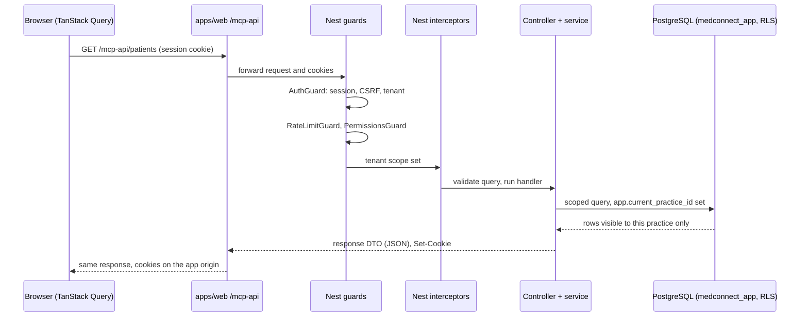

# Request lifecycle

One request traced end to end, in live mode and in mock mode, plus one write. Each step links to the
code that does it. Rules (roles, permissions, tenant resolution) are defined in
[identity-and-access.md](../contracts/identity-and-access.md); schemas are in the generated
OpenAPI document. Neither is repeated here. Overview: [README.md](README.md).

## Live read: patient list



1. **Query hook.** `usePatientSearch` keys the cache on search, status and sort, and calls
   `medicalAPI.searchPatients`
   ([use-medical.ts:32-34](../../apps/web/src/lib/hooks/use-medical.ts)). In live mode
   `medicalAPI` is the real client
   ([medical-api.ts:233](../../apps/web/src/lib/api/medical-api.ts)).
2. **HTTP client.** `apiFetch` sends the request with `credentials: 'include'`
   ([http.ts:214-219](../../apps/web/src/lib/api/http.ts)) to the base URL from
   [nest-api.ts](../../apps/web/src/lib/api/nest-api.ts): `/mcp-api` on the hosted demo, or an
   absolute API URL locally.
3. **Same-origin proxy.** The catch-all route
   ([mcp-api route.ts](../../apps/web/src/app/mcp-api/[[...path]]/route.ts)) forwards to the API
   and copies `Set-Cookie` back so session cookies stay first-party and host-only
   ([mcp-api-proxy.ts:57-96](../../apps/web/src/lib/api/mcp-api-proxy.ts);
   [ADR-017](../decisions/ADR-017-interim-render-demo.md),
   [ADR-018](../decisions/ADR-018-render-marketing-static-site.md)).
4. **Identity and tenant.** Global guards run in registration order
   ([identity.module.ts:72-74](../../apps/api/src/identity/identity.module.ts)). `AuthGuard` reads
   a bearer token or the HttpOnly access cookie, applies the cookie CSRF check on mutations
   ([csrf.ts](../../apps/api/src/identity/csrf.ts)), resolves the session's practice membership,
   rejects any client `practiceId` that differs from it, and stores the result in `TenantContext`
   ([auth.guard.ts:29-63](../../apps/api/src/identity/auth.guard.ts);
   [ADR-016](../decisions/ADR-016-super-admin-session-tenant-scope.md)).
5. **Rate limit.** `RateLimitGuard` applies only to routes marked with a policy
   ([ADR-015](../decisions/ADR-015-rate-limiting-and-api-protection.md)).
6. **Role and permission.** `PermissionsGuard` checks the role's permissions when the handler
   declares `@RequirePermissions`, and passes otherwise
   ([permissions.guard.ts:18-37](../../apps/api/src/identity/permissions.guard.ts)). The patient
   list declares none; its role rule lives in the service (step 8).
   A tenant mismatch in `AuthGuard` and a missing permission in `PermissionsGuard` each record a
   denied audit event before rejecting
   ([auth.guard.ts:51](../../apps/api/src/identity/auth.guard.ts),
   [permissions.guard.ts:36](../../apps/api/src/identity/permissions.guard.ts)).
7. **Interceptors.** `AuditAccessDeniedInterceptor` records a denied audit event when the service
   throws a permission error
   ([audit-access-denied.interceptor.ts:19-26](../../apps/api/src/audit/audit-access-denied.interceptor.ts)).
   `TenantRlsInterceptor` runs the handler inside an async-local store holding the practice id
   ([tenant-rls.interceptor.ts:17](../../apps/api/src/tenancy/tenant-rls.interceptor.ts);
   both registered in [app.module.ts:46-47](../../apps/api/src/app.module.ts)). The query string
   is validated against its schema before the handler runs
   ([patient.controller.ts:49-60](../../apps/api/src/patient/patient.controller.ts)).
8. **Resource scope.** The service maps the role to a read scope: practice-wide, assigned
   patients only (nurse) or own record only (patient), or denied
   ([patient.service.ts:65-77](../../apps/api/src/patient/patient.service.ts),
   [patient-access.ts:11](../../apps/api/src/patient/patient-access.ts)).
9. **Database.** The repository filters on the server-resolved `practiceId`
   ([patient.repository.ts:83](../../apps/api/src/practice/patient.repository.ts)). Before each
   query the TypeORM subscriber sets `app.current_practice_id`
   ([tenant-rls.subscriber.ts:9-17](../../apps/api/src/persistence/tenant-rls.subscriber.ts)),
   and RLS policies compare rows against it
   ([TenantRowLevelSecurity migration](../../apps/api/src/persistence/migrations/1760000000007-TenantRowLevelSecurity.ts)).
   The runtime role `medconnect_app` is not the table owner, so it cannot bypass RLS
   ([ADR-010](../decisions/ADR-010-postgresql-typeorm.md)). Service scoping and RLS are two
   independent layers ([ADR-002](../decisions/ADR-002-tenant-isolation.md)).
10. **Response.** The handler returns a response DTO (RDO); its schema is in the generated OpenAPI
    ([ADR-004](../decisions/ADR-004-api-contracts.md)). Errors use one envelope
    ([http-exception.filter.ts](../../apps/api/src/platform/http-exception.filter.ts)).
11. **Cache.** The proxy returns the response unchanged and TanStack Query stores the page under
    its query key.

Nest runs guards before interceptors and validation, so an unauthenticated or forbidden request
never reaches schema validation or the service.

## Write: change a user's role

`PATCH /admin/users/:id/roles` from the administration screen.

1. **Mutation.** `useAssignUserRole` calls `adminAPI.assignRole`
   ([use-admin.ts:44-49](../../apps/web/src/lib/hooks/use-admin.ts),
   [admin-api.ts:31](../../apps/web/src/lib/api/admin-api.ts)). The request goes through the same
   `/mcp-api` proxy; the client adds the `X-CSRF-Token` header from the CSRF cookie
   ([http.ts:117-118](../../apps/web/src/lib/api/http.ts)), which `AuthGuard` checks on cookie mutations.
2. **Guards.** `AuthGuard` resolves the session practice as above. `PermissionsGuard` requires
   `admin:users`
   ([practice-user.controller.ts:52-53](../../apps/api/src/practice/practice-user.controller.ts)).
3. **Service rules.** The service looks up the membership in the session practice only (unknown
   and cross-tenant ids both return not found), stops a `PRACTICE_ADMIN` from granting
   `SUPER_ADMIN`, and keeps the last `PRACTICE_ADMIN`
   ([practice-user.service.ts:35-50](../../apps/api/src/practice/practice-user.service.ts)).
4. **Write and audit.** The membership row is updated, then a `membership.role_changed` audit
   event is recorded with the request correlation id
   ([practice-user.service.ts:55-61](../../apps/api/src/practice/practice-user.service.ts),
   [audit-event.repository.ts:54](../../apps/api/src/audit/audit-event.repository.ts)). Both
   queries run as `medconnect_app` under RLS.
5. **Response and cache.** The updated user DTO is returned. The hook patches that user in the
   cached user list and invalidates the audit-event query so the new event appears
   ([use-admin.ts:50-63](../../apps/web/src/lib/hooks/use-admin.ts)).

A denied attempt returns the error envelope and is recorded as a denied audit event: by
`PermissionsGuard` when `admin:users` is missing, or by `AuditAccessDeniedInterceptor` when the
service blocks the grant.

**Document upload** follows the same chain on the API side only; the web app lists documents but has
no upload screen. `POST /patients/:id/documents` takes a multipart file
([documents.controller.ts:66-69](../../apps/api/src/documents/documents.controller.ts)); the service
checks the patient is visible, checks the upload role, validates the file, stores it and records an
audit event ([document.service.ts:48-56](../../apps/api/src/documents/document.service.ts),
[document.service.ts:132-133](../../apps/api/src/documents/document.service.ts)).

## Mock mode

When `NEXT_PUBLIC_USE_MOCKS=true`, or under `NODE_ENV=test`, `isMockMode()` is true
([runtime.ts:7-8](../../apps/web/src/lib/api/mocks/runtime.ts)) and each API module exports its
mock implementation instead of the real one (for example
[medical-api.ts:233](../../apps/web/src/lib/api/medical-api.ts),
[admin-api.ts:81](../../apps/web/src/lib/api/admin-api.ts)). The query hooks and screens are
unchanged.

```text
Query hook → mock API module → in-browser fixtures → query cache
```

No request reaches `/mcp-api`, Nest or PostgreSQL, so there is no session, tenant check, RLS or
audit event. Role checks in the UI are display only. Mock mode is used by `npm run dev:mocks`,
Vitest, `npm run e2e:mocks` and Render PR previews
([ADR-019](../decisions/ADR-019-render-pr-previews.md)). Live behavior is covered by API tests and
`e2e:live`.
