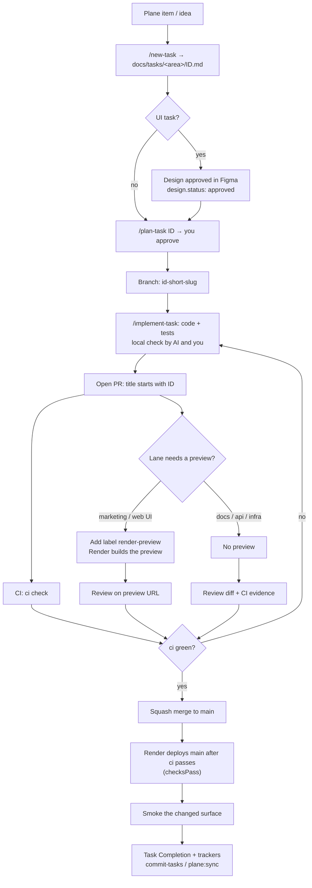

# Delivery lanes

How a change travels from a task to the interviewer demo, and which checks and previews it gets.
Task lifecycle stages stay in [feature-development.md](feature-development.md). Hosting decisions:
[ADR-017](../decisions/ADR-017-interim-render-demo.md),
[ADR-018](../decisions/ADR-018-render-marketing-static-site.md),
[ADR-019](../decisions/ADR-019-render-pr-previews.md).

> **Status:** this is the target flow for M20. Render previews shipped with INFRA-019 (see
> [deploy-render.md](deploy-render.md#pr-previews)). INFRA-020 added the `checksPass` deploy gate,
> the Render PR comment and the PR template. The PR-only rule holds once branch protection on
> `main` is applied (operator step recorded in the INFRA-020 task).

## Systems

| System | Owns | Not the source for |
| --- | --- | --- |
| `docs/` in Git | Task specs, ADRs, contracts, acceptance criteria | Operational status |
| Plane | Operational status, milestone view (synced by `npm run plane:sync`) | Requirements |
| GitHub | Branches, PRs, CI (`ci` check), review | Task specs (no GitHub Issues) |
| Render | Interviewer demo from `main`, PR previews | AWS target topology (M9) |

One task ID (`FE-048`) links them: branch name, PR title, task file, Plane item.

## The flow

## Lanes

Pick the lane from the paths the PR changes. If a PR spans lanes, use the strictest one.

| Lane | Typical paths | Branch + PR | CI | Render preview | Review on | Version (ADR-007) |
| --- | --- | --- | --- | --- | --- | --- |
| **Docs** | `docs/**`, `*.md`, `.claude/**` | Yes. Batch small doc fixes into one PR. | Full `ci` (fast enough; no path filter yet) | None | Diff | None |
| **Marketing** | `apps/marketing/**`, `apps/web/src/styles/tokens.css` | Yes | Full `ci` | Marketing static site (free) | Preview URL, desktop + 320 px | PATCH or MINOR |
| **Web UI** | `apps/web/**` (no contract change) | Yes | Full `ci`, plus `e2e:mocks` locally | Web, mock mode | Preview URL with demo accounts (mock fixtures) | PATCH or MINOR |
| **API / data / security** | `apps/api/**`, migrations, `docs/contracts/**` | Yes | Full `ci` (API tests on throwaway Postgres) | None | Diff, CI, local `e2e:live` | MINOR for contract or security changes; docs + changelog in the same PR |
| **Infra / CI** | `render.yaml`, `.github/**`, `infra/**`, `scripts/infra/**` | Yes, and ask before editing | Full `ci` | Only if the change is a preview setting | Diff, Render dashboard after merge | Per change |
| **Full stack** | Web + API together | Yes | Full `ci` | Web (mock mode) for the UI half | Preview for UI, local `e2e:live` for integration | Per the API half |

Rules shared by every lane:

- Every change goes through a PR, including docs. `main` is the demo deploy.
- No long-lived milestone branches. A milestone is several small PRs. Hide unfinished UI behind an
  unlinked route or a flag rather than holding a branch open.
- Previews never use production secrets, real PHI, or the interviewer database.
- A PR is not review-ready until `ci` is green.

## What a web preview is and is not

| It shows | It does not show |
| --- | --- |
| Layout, design parity, responsive behaviour, focus order, copy | Live API behaviour, RLS, rate limits, cookies from Nest |
| Role-based UI using mock fixtures and the demo account panel | Interviewer seed data |
| Error and empty states the mocks produce | Telehealth media, OAuth |

If a reviewer needs live behaviour, run `npm run dev:real` against local Compose, or wait for the
merged deploy.

## Example: Pencil exploration to marketing page

1. Pencil is exploration only. Approve the chosen parts in the shared Figma file
   ([ADR-011](../decisions/ADR-011-figma-canonical-visual-source.md)).
2. `/new-task` creates an `FE-` task with `design.tool: figma`, the frame, and
   `design.status: approved`.
3. `/plan-task`, approve, branch `fe-0xx-landing-sections`, `/implement-task`.
4. PR titled `FE-0xx …` with label `render-preview`. Marketing lane: Render builds the static
   preview only.
5. Review the preview against the Figma frame at desktop and 320 px. Merge when `ci` is green.

## Later

- **Paid preview backend:** a shared preview API and preview Postgres, separate from the
  interviewer database. Web previews then switch from mocks to that API (ADR-019).
- **Docs fast lane:** skip heavy CI jobs on docs-only PRs once CI time becomes a problem. The
  required `ci` check must still report on every PR.
- **AWS (M9):** Amplify PR previews against the shared preview ECS API
  ([INFRA-010](../tasks/infrastructure/INFRA-010-preview-environment-and-pr-delivery.md)). The lanes
  above stay the same; only the host changes.
